<!-- =========================================================
     TANMAY SHARMA | GITHUB PROFILE
     ========================================================= -->

<!-- HERO BANNER -->

  <picture>
    <source
      media="(prefers-color-scheme: dark)"
      srcset="https://raw.githubusercontent.com/tanmaxsharma/tanmaxsharma/main/dark.svg"
    />
    <source
      media="(prefers-color-scheme: light)"
      srcset="https://raw.githubusercontent.com/tanmaxsharma/tanmaxsharma/main/light.svg"
    />
    
  </picture>

<!-- PROFILE LINKS -->

  <a href="https://www.tanmaxsharma.in">Portfolio</a>
  &nbsp; · &nbsp;
  <a href="https://www.linkedin.com/in/tanmaxsharma">LinkedIn</a>
  &nbsp; · &nbsp;
  <a href="mailto:tanmaysharma.eng05@gmail.com">Email</a>

 

---

<!-- ABOUT ME -->

<h2 align="center">About Me</h2>

  I'm <strong>Tanmay Sharma</strong>, a Full-Stack Developer with
  <strong>3+ years of professional experience</strong>, focused on
  designing, developing, and deploying production-oriented software.

  I work primarily with <strong>React, Next.js, Node.js, and TypeScript</strong>.
  My experience spans the complete development lifecycle — from frontend
  architecture and API engineering to database design, third-party
  integrations, deployment, and infrastructure.

  Beyond development, I'm interested in product engineering, system
  architecture, and applied AI automation. I enjoy solving practical
  business problems through reliable and maintainable software.

  Currently building and contributing to software initiatives at
  <strong>Gradmarc Adtech LLP</strong>.

 

---

<!-- WHAT I BUILD -->

<h2 align="center">What I Build</h2>

  
  
  
  
  
  

 

---

<!-- TECHNOLOGY STACK -->

<h2 align="center">Technology Stack</h2>

<h3 align="center">Frontend Development</h3>

  

<h3 align="center">Backend & APIs</h3>

  

<h3 align="center">Databases & ORM</h3>

  

<h3 align="center">Cloud & DevOps</h3>

  

<h3 align="center">Tools & Workflow</h3>

  

<h3 align="center">AI & Automation</h3>

  

 

---

<!-- ENGINEERING APPROACH -->

<h2 align="center">Engineering Approach</h2>

  
    
  ↓
    
  
    
  ↓
    
  
    
  ↓
    
  
    
  ↓
    
  
    
  ↓
    
  

 

---

<!-- GITHUB ANALYTICS -->

<h2 align="center">GitHub Analytics</h2>

  

<!-- SELF-HOSTED GITHUB STATS
     Enable after completing Vercel deployment.

  
  

-->

 

---

<!-- CONTRIBUTION ACTIVITY -->

<h2 align="center">Contribution Activity</h2>

  

  <picture>
    <source
      media="(prefers-color-scheme: dark)"
      srcset="https://raw.githubusercontent.com/tanmaxsharma/tanmaxsharma/output/github-snake-dark.svg"
    />
    <source
      media="(prefers-color-scheme: light)"
      srcset="https://raw.githubusercontent.com/tanmaxsharma/tanmaxsharma/output/github-snake.svg"
    />
    
  </picture>

 

---

<!-- CURRENT FOCUS -->

<h2 align="center">Currently Exploring</h2>

  Backend Architecture & Scalable System Design
   
  Cloud Infrastructure & Deployment Automation
   
  AI-Powered Applications & Workflow Automation
   
  Product Engineering & Performance Optimization

 

---

<!-- CONNECT -->

<h2 align="center">Let's Connect</h2>

  I'm open to interesting engineering opportunities,
  product collaborations, and challenging software projects.

  
  &nbsp;
  
  &nbsp;
  

  Building · Engineering · Automating

