<!-- ==================== HERO BANNER ==================== -->

  <picture>
    <source
      media="(prefers-color-scheme: dark)"
      srcset="https://raw.githubusercontent.com/tanmaxsharma/tanmaxsharma/main/dark.svg"
    />
    <source
      media="(prefers-color-scheme: light)"
      srcset="https://raw.githubusercontent.com/tanmaxsharma/tanmaxsharma/main/light.svg"
    />
    
  </picture>

<!-- ==================== PROFILE LINKS ==================== -->

  <a href="https://www.tanmaxsharma.in">Portfolio</a>
  &nbsp;·&nbsp;
  <a href="https://www.linkedin.com/in/tanmaxsharma">LinkedIn</a>
  &nbsp;·&nbsp;
  <a href="mailto:tanmaysharma.eng05@gmail.com">Email</a>

---

<!-- ==================== ABOUT ==================== -->

<h2 align="center">About Me</h2>

I'm **Tanmay Sharma**, a Full-Stack Developer with **3+ years of professional experience**, focused on designing, developing, and deploying production-oriented software.

I work primarily with **React, Next.js, Node.js, TypeScript, and modern backend technologies**. My experience spans the complete development lifecycle — from frontend architecture and API engineering to database design, third-party integrations, deployment, and infrastructure.

Beyond development, I'm interested in product engineering, system architecture, and applied AI automation. I enjoy solving practical business problems through reliable and maintainable software.

- Building full-stack applications and business platforms.
- Designing scalable APIs and database architectures.
- Integrating payments, authentication, and third-party services.
- Working with cloud infrastructure and deployment automation.
- Exploring AI-powered workflows and product engineering.

Currently building and contributing to software initiatives at **Gradmarc Adtech LLP**.

---

<!-- ==================== WHAT I BUILD ==================== -->

<h2 align="center">What I Build</h2>

  
  
  
  
  
  

---

<!-- ==================== TECHNOLOGY STACK ==================== -->

<h2 align="center">Technology Stack</h2>

  <strong>Frontend</strong>  
  

  <strong>Backend & APIs</strong>  
  

  <strong>Databases & ORM</strong>  
  

  <strong>Cloud & DevOps</strong>  
  

  <strong>Tools & Workflow</strong>  
  

  <strong>AI & Automation</strong>  
  

---

<!-- ==================== SELECTED PROJECTS ==================== -->

<h2 align="center">Selected Projects</h2>

<table width="100%">
  <tr>
    <td width="50%" valign="top">
      <h3>Event Discovery & Ticketing Platform</h3>
      A full-stack event platform with attendee, organizer, admin, and ticket-scanning workflows.

        
      <strong>Technologies</strong> 
      Next.js · TypeScript · PostgreSQL · Prisma · Better Auth · Razorpay · Redis · BullMQ
    </td>
    <td width="50%" valign="top">
      <h3>QR Live Image Sharing</h3>
      A QR-based event photo-sharing platform that enables guests to upload and access shared event memories.

        
      <strong>Technologies</strong> 
      Next.js · TypeScript · Cloudinary · Vercel · QR Integration
    </td>
  </tr>
  <tr>
    <td width="50%" valign="top">
      <h3>ERP & Learning Management System</h3>
      Enterprise-oriented institutional software covering academic and administrative workflows.

        
      <strong>Technologies</strong> 
      React · PHP · CodeIgniter · MySQL
    </td>
    <td width="50%" valign="top">
      <h3>AI Lead Automation</h3>
      Workflow automation for lead processing and business communication using AI-powered integrations.

        
      <strong>Technologies</strong> 
      n8n · Claude AI · APIs · Automation Workflows
    </td>
  </tr>
  <tr>
    <td width="50%" valign="top">
      <h3>News Portal</h3>
      News publishing platform with content management and AI-assisted editorial workflow development.

        
      <strong>Technologies</strong> 
      MERN · React · Node.js · MongoDB · AI Integration
    </td>
    <td width="50%" valign="top">
      <h3>Customer Relationship Management</h3>
      Business-oriented CRM functionality for managing customer information and operational workflows.

        
      <strong>Technologies</strong> 
      React · Node.js · Express · MongoDB
    </td>
  </tr>
</table>

  

---

<!-- ==================== ENGINEERING APPROACH ==================== -->

<h2 align="center">Engineering Approach</h2>

  
   ↓ 
  
   ↓ 
  
   ↓ 
  
   ↓ 
  
   ↓ 
  

---

<!-- ==================== GITHUB ANALYTICS ==================== -->

<h2 align="center">GitHub Analytics</h2>

  

<!--
ADD SELF-HOSTED STATS AFTER VERCEL DEPLOYMENT.

Replace YOUR-INSTANCE with your deployed Vercel domain.

  
  

-->

---

<!-- ==================== CONTRIBUTION SNAKE ==================== -->

<h2 align="center">Contribution Activity</h2>

  

  <picture>
    <source
      media="(prefers-color-scheme: dark)"
      srcset="https://raw.githubusercontent.com/tanmaxsharma/tanmaxsharma/output/github-snake-dark.svg"
    />
    <source
      media="(prefers-color-scheme: light)"
      srcset="https://raw.githubusercontent.com/tanmaxsharma/tanmaxsharma/output/github-snake.svg"
    />
    
  </picture>

---

<!-- ==================== CURRENT FOCUS ==================== -->

<h2 align="center">Currently Exploring</h2>

  Backend architecture and scalable system design 
  Cloud infrastructure and deployment automation 
  AI-powered applications and workflow automation 
  Product engineering and performance optimization

---

<!-- ==================== CONNECT ==================== -->

<h2 align="center">Let's Connect</h2>

  I'm open to interesting engineering opportunities, product collaborations, and challenging software projects.

  
  &nbsp;
  
  &nbsp;
  

  Building · Engineering · Automating

